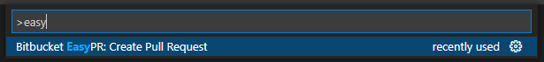

# Bitbucket EasyPR
Visual Studio Code extension that allows you to create a pull request in Bitbucket with an easy command.

You can download clicking [here.](https://marketplace.visualstudio.com/items?itemName=luizgununes.bitbucketeasypr)

## ⚠️ Important: API Token Required

As of September 2025, Bitbucket has replaced App passwords with **API tokens**. To use this extension, you need to:

1. **Find your Atlassian account email**:
   - Go to [Bitbucket Personal settings](https://bitbucket.org/account/settings/)
   - Your email is listed under "Email Aliases"
   - You'll need this email for authentication

2. **Create an API token** in your Bitbucket account:
   - Go to [Atlassian Account Settings > Security > API tokens](https://id.atlassian.com/manage-profile/security/api-tokens)
   - Click "Create API token with scopes"
   - Give it a name (e.g., "VS Code EasyPR") and an expiry date
   - Select **Bitbucket** as the app
   - Select the following scopes:
     - ✅ **Repositories: Read** (to read repositories and branches)
     - ✅ **Repositories: Write** (to access repository details)
     - ✅ **Pull requests: Write** (to create pull requests)
   - Click "Create token" and **save your token** (you won't be able to see it again!)

3. The extension will prompt you for:
   - Your **Atlassian account email**
   - Your **API token**
   - Workspace and project names

For more information, see [Bitbucket API tokens documentation](https://support.atlassian.com/bitbucket-cloud/docs/api-tokens/).

## Usage
Use the command palette (⇧⌘P) to create a pull request by selecting the "Bitbucket EasyPR: Create Pull Request" command.

